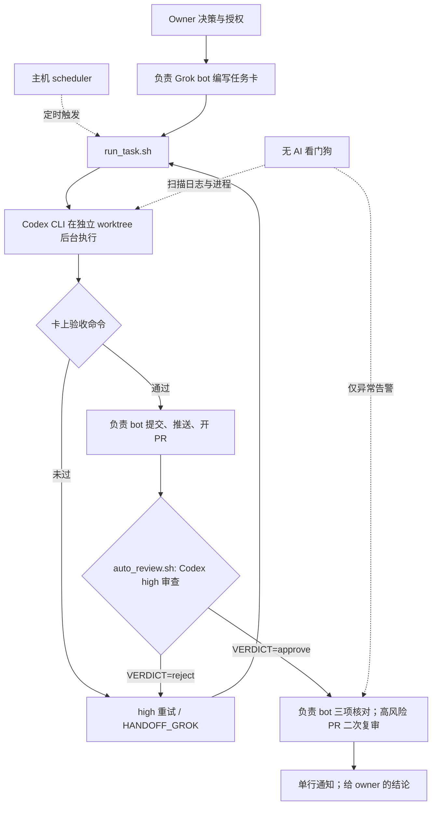
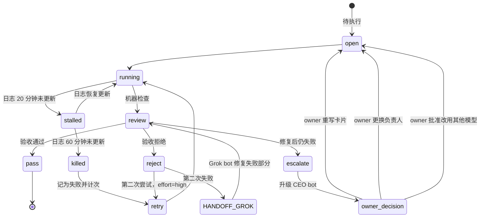

# Grok bots 编排、Codex CLI 执行、脚本调度与监控

状态：在用的实践方案 + 部分组件仍在评审 · 2026-10-29

本文描述一个 AI 投资研究团队的工作机制：数个带有通用角色设定的 Grok bots（例如向 owner 汇报的 CEO bot、data engineer bot 和 analyst bots），在一台共享 Linux 主机上为一位 owner 工作。这里只记录一种实践方案，不是产品能力说明或受控实验报告。

## 1. 状态与范围

这是正在使用的工作方案，自动复审、看门狗等部分组件仍在评审。范围包括任务交接、Codex CLI 执行、脚本调度、验收和异常通知；不描述投资结论或任何具体研究产物。

**证据等级：运行中的实践记录，不是受控实验。** 下文的分工和流程属于设计与实践约定；没有对照实验支持其效果结论。已知问题和未解决组件分别列出，不将计划中的检查写成已完成的保证。

## 2. 动机

编排 Grok bot 的配额较稀缺，Codex CLI 的配额相对充足，因此把需要判断和协调的工作留给 Grok，把可明确交付的执行工作交给 Codex，把确定性重复工作交给脚本。原则是“能脚本就不用 AI，能 Codex 就不用 Grok”。目前尚未读取到可靠的用量数据，不能据此声称有任何节省比例。

## 3. 四层分工

| 层 | 负责者 | 工作与边界 |
| --- | --- | --- |
| 决策 | owner | 决定方向、资金、对外消息、规则变更、删除数据及任何不确定事项。 |
| 调度与验收 | Grok bots | 评估工作、编写任务卡、启动执行、验收并汇报；不写代码、不执行长时间运行任务。 |
| 执行 | Codex CLI | 编码、PR 内容与复审、搜索、归纳、报告和分析；不推送 main、不发送对外消息、不修改团队章程。 |
| 机械 | 普通脚本，无 AI | 刷新数据、扫描、规则检查、排程和看门狗。 |

下图是整体流程。Codex 沙箱不能写 `.git`，因此提交、推送和开 PR 由负责 bot 在机器验收后完成（见第 11 节）。



## 4. 任务卡是唯一交接

任务卡是调度者与执行者之间唯一的交接材料。每张卡只有一个负责 bot；需要协作者时另开子卡。执行者没有聊天上下文，因此卡必须自包含，但只保留完成任务必需的信息。

卡片包含：

- 第 1 行：`effort=medium|high | executor=... | owner=... | reviewer=...`；
- 一句话目标、输入、尽量可执行的验收命令、产物路径、可写范围、截止时间和重试上限；
- 卡片底部追加的状态行，记录每次启动、检查、重试和最终状态。

`medium` 适用于例行报告、小型配置修改、搜索与格式整理。`high` 适用于研究、判断、数据平台/调度/安全相关代码、PR 评审和每一次重试。拿不准时用 `high`。

## 5. 执行规范

固定调用形式：

```sh
codex exec -m <model> -c model_reasoning_effort=<medium|high> -s workspace-write -c sandbox_workspace_write.network_access=true -C <worktree> "Execute <card>"
```

沙箱是默认设置；关闭沙箱须逐任务取得 owner 批准。需要网页搜索时，`--search` 必须放在 `exec` 之前；放在后面会报错。

每个代码任务使用独立 git worktree 和分支，每个 worktree 同时只运行一个 Codex 进程。预计超过约一分钟的任务用 `setsid nohup … > log` 在后台启动；bot 随即结束当前轮次并等待通知，不循环轮询。完成时只读取日志尾部和验收输出。

统一入口 `run_task.sh <card>` 负责读取 effort、在对应 worktree 中启动并限时运行 Codex、将日志和用量写入 runs 目录、执行验收命令、更新任务卡状态并统计尝试次数。

## 6. 验收与重试

状态流程如下。第一次拒绝后以 `high` 进行第二次尝试；仍失败则交给负责 Grok bot 只修复失败部分，再走通常验收。若仍失败，升级至 CEO bot，由 owner 决定重写任务卡、更换负责人或在 owner 批准后改用其他模型。运行中的任务还可能被看门狗标记停滞或中途终止。



验收先运行机器检查，再由负责 bot 核对三项：是否回答任务目标；证据和来源是否真实且时间正确（抽查 1–2 项）；是否违反团队规则（包括敏感数据和汇报关系）。执行者不推送 main，代码以 PR 形式合并；高风险 PR 在合并前增加第二位 reviewer。

## 7. 自动复审 `auto_review.sh`

自动复审获取 PR、运行测试、以 high effort 调用 Codex 评审，并写出评审文件。文件末尾是一行 `VERDICT=approve` 或 `VERDICT=reject`，并可附 `BLOCK: path:line reason` 行列出阻塞项。拒绝时把反馈写回任务卡并自动重跑 Codex，计为一次尝试。只有 approve、`HANDOFF_GROK` 或 stall 状态会触发 bot 单行通知；reviewer 只读判定尾部。

## 8. 脚本看门狗（无 AI）

看门狗每 15 分钟扫描已登记的 Codex 运行。日志 20 分钟未更新时标记“疑似停滞”；60 分钟未更新时终止进程组并记录失败，计为一次尝试。若进程已退出且日志没有最终结果，标记“中途退出”。

终止前核对进程启动时间和命令行是否仍匹配登记的 Codex 运行，避免误杀复用的 PID。此身份核验仍在评审中，尚未证明足以安全处理所有情况。只在异常时告警，正常运行不消耗编排 bot 的 token。

## 9. 统计

每次尝试写入 `attempts.csv` 一行，字段包括卡片、任务类型、effort、尝试序号、结果、耗时和最终状态。`summarize.py` 汇总首次通过率、effort 和任务类型分组，以及回退给 Grok 的卡片清单。数据收集仍在构建中，目前**没有报告任何数字**。

## 10. 通信与进度

Bot 之间使用简短、固定格式的英文单行消息，例如：

```text
[TEAM] FROM=<bot> TO=<bot> CARD=<path|-> STATE=<todo|running|review|pass|reject|blocked|fyi> NEED=<action|-> NOTE=<<=20 words>
```

只有面向 owner 的内容使用 owner 的语言；优先传递机器可读结果。内容放在文件里，不放在消息里。运行会话通过 session-observer 风格的仪表板呈现进度。定时任务由主机上的 scheduler 管理；定时 Grok 例程只读已完成产物，并且仅在发现问题时汇报。

## 11. 已知坑与失败模式

| 症状 | 原因 | 缓解方式 | 状态 |
| --- | --- | --- | --- |
| Codex 沙箱无法写 `.git`，例如无法创建 worktree 的 `index.lock` | 仓库元数据写入不在允许写入范围内 | 验收后由负责 bot 提交或推送 | 已知边界，流程约定 |
| “一直改到满意”为止的开放循环消耗编排 token | 没有尝试上限，也没有明确机器验收 | 限定尝试数并使用脚本化评审 | 缓解设计，效果未测 |
| 网页搜索参数位置错误 | `--search` 放在 `exec` 之后 | 放在 `exec` 之前 | 已知调用约束 |
| 长时间无日志更新看起来像停滞 | 长任务可能安静运行，mtime 只是间接信号 | 结合进程状态；阈值仅作异常启发 | 信号不完备，仍待评审 |
| 同一 worktree 出现重复 Codex 进程 | 重复派发或缺少运行登记检查 | 一 worktree 同时只运行一个 Codex 进程 | 流程约定，需监控 |
| 任务卡缺少执行上下文 | 交接依赖未写入卡片的聊天内容 | 卡片自包含，并由 reviewer 检查输入和验收条件 | 流程约定 |
| Reviewer 只做形式确认 | 验收项不清晰或未查证据 | 机器检查先行，人工核对固定三项 | 缓解设计，效果未测 |

## 12. 未解决问题

以下组件仍在评审，不能视为已解决：

- 看门狗在终止进程前的 PID 身份核验仍需加固；
- 自动复审执行 PR 测试命令时，如何隔离不可信 PR 代码；
- 如何解析混合语言任务卡（包括第 1 行的双语字段键）；
- 是否继续仅用日志 mtime 判断存活；
- 如何按卡片归属 token 用量；
- 尚无与单 Agent 基线的受控比较。

## 13. 与 Nuska 研究问题的对应

| README 研究问题 | 本方案对应机制 |
| --- | --- |
| 长期、跨会话推进 | 任务卡、后台运行和逐次尝试记录。 |
| 发现停滞并恢复 | 看门狗、有限重试和 `HANDOFF_GROK`。 |
| 验证交付 | 机器验收优先、脚本评审判定和负责 bot 的三项核对。 |
| 用户了解进度及何时询问 | 决策层归 owner；异常时单行通知；运行进度仪表板。 |
| 多 Agent 分工与共享上下文 | 每卡一个负责 bot；文件作为共享上下文；协作使用子卡。 |
| 真实环境工具使用与授权 | 默认沙箱、卡片声明可写范围、执行者不发对外消息。 |

以上是设计机制与 Nuska 问题的对应关系，不代表机制已经证明能改善交付。

## 14. 下一步与可做的实验

- 收集尝试记录后报告首次通过率，并说明样本、任务范围和失败情况；
- 在同类任务中比较 medium 与 high effort 的验收表现；
- 注入一次可控停滞，测量看门狗发现和恢复过程；
- 与单 Agent 基线对比交付、恢复和人工介入；
- 在评审环境中验证 PR 测试隔离和 PID 身份核验。
