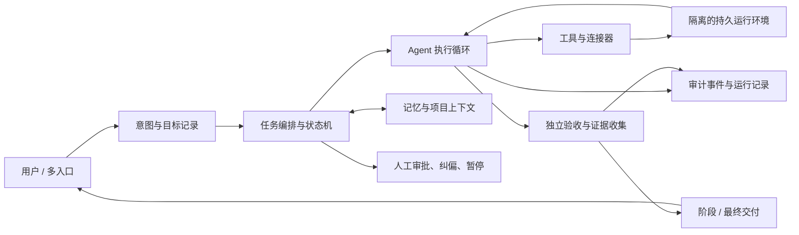

# Grok Bot 与个人交付型 Agent：原理、架构、验收、提示词及产品对照

状态：已完成公开资料初查；产品行为基于官方文档，项目能力基于当前公开仓库；未实测任何产品。  
日期：2026-10-31

## 问题和范围

本研究回答两个问题：

1. Grok Bot 展现出的“理解目标、跨工具持续推进、阶段更新、交付结果”的产品机制，公开资料能支持哪些判断？有哪些适合复用的工程架构、验收标准和 Agent 提示词？
2. OpenAI Dots 与 Claude Cowork 是否已经足以实现一个个人使用、能理解意图并交付、由人验收的 Agent？有哪些开源项目可作工程参照？

“Grok Bot”指 xAI 当前 Grok Bot 产品，不等同于 X 上传统的 @Grok 问答机器人，也不等同于 Grok 聊天模型。提示词方面，本文使用 xAI 官方公开的 Grok 对话提示词仓库作为风格和行为参考；它没有证明那就是 Grok Bot 内部的完整系统提示词。

## 材料和方法

查阅 xAI、OpenAI、Anthropic 官方产品说明和公开提示词仓库，及 OpenClaw、OpenHands、Goose 的公开 GitHub 文档。另对照 Nuska 已有 Grok Bot 逆向资料和长任务交付评测草案。日期为 2026-10-31；产品文档、仓库主分支和计划权益可能继续变化。本文没有登录产品、运行基准或验证实际交付率。

## 研究一：Grok Bot 的工作机制与可借鉴架构

### 官方描述确认了什么

xAI 将 Grok Bot 描述为有名字、职责和持续上下文的 AI teammate；每个 Bot 使用持久云端电脑，其中有浏览器、文件系统和终端。Bot 接收自然语言任务后可以跨应用多步执行、在对话中更新进展，并在需要批准时回到用户处。[Grok Bot 概览](https://docs.x.ai/grok-bot/overview)

官方文档进一步描述：Bot 可以并行运行、互相发消息、在群聊共享上下文并移交任务；一次演示工作流可以保存为 Skill 并按计划重复；Bot 的记忆、文件、浏览器会话和偏好跨会话保留。账号下各 Bot 共用一台云电脑，因此文件、浏览器会话及登录态也共用。[Grok Bot 概览](https://docs.x.ai/grok-bot/overview) 文档中的协作建议要求为每个阶段明确负责人；工作流 Skill 可包含输入、步骤、验证和安全边界，Routine 则负责按时间或事件触发。[协作说明](https://docs.x.ai/grok-bot/chat-and-collaboration) · [Skills 与 routines](https://docs.x.ai/grok-bot/skills-routines-and-automations)

这些是产品能力陈述，能说明产品外部模型，不能证明服务端采用了某一种任务队列、状态机或提示词，也不能证明长任务可靠率。第三方对 Grok Bot 0.70.2 的静态分析可提供客户端协议和子系统的研究线索，但其作者明确区分静态观察、推断和未知；这不是当前服务端设计的权威证明。[Grok Bot 0.70.2 研究快照](https://github.com/oceanz0312/grok-bot-analysis/tree/272439bf4ff4ecc3bdb8190dbdd78fecd00f7b20)；Nuska 已有[资料边界说明](../sources/2026-10-29-grok-bot-analysis.md)

### 对工程架构的合理重建（推断，不是 xAI 实现披露）

从公开行为倒推，一个可实现相似体验的系统至少需要这些层：



关键的工程对象不是“更长的 prompt”，而是持久化目标、任务状态、执行环境、交付清单、验收证据和人类决策边界。模型提示词负责把目标转成行动、持续重读当前状态并对工具结果作反应；外层运行时必须保存状态、处理重试/中断、隔离权限并判定任务是否真的完成。这个分层与 OpenHands 文档中 Agent 推理动作循环、事件流、Runtime 和安全分析器的职责划分相符，但这里的图是个人 Agent 的建议架构。[OpenHands Agent 架构](https://github.com/OpenHands/docs/blob/main/docs/sdk/arch/agent.mdx)

建议核心实体：

| 实体 | 最小字段 | 用途 |
| --- | --- | --- |
| Goal | 用户目的、约束、优先级、截止时间、当前版本 | 避免把聊天记录误当成目标；支持后续修订 |
| Task | 负责人、前置条件、状态、重试策略、父子关系 | 追踪执行和委派；防止“发出去”被记成“完成” |
| Deliverable | 路径/链接、版本、所满足的条件、状态 | 使结果可检查、可打开、可继续使用 |
| Evidence | 自动检查结果、来源、时间、人工判断 | 支持有据可查的完成声明 |
| Decision | 需用户审批的动作、理由、选项、等待状态 | 把不可逆或代表用户的决定交还人类 |
| Event | 输入、工具调用、观察、失败、重试、变更 | 支持审计、恢复和复盘 |

### Grok 对话提示词公开程度与可借鉴处

xAI 公开维护 [xai-org/grok-prompts](https://github.com/xai-org/grok-prompts)，列有 Grok 3/4/4.1 对话提示词、X 上 Grok bot 提示词以及特定模型安全提示词。该仓库明确称其为 Grok 聊天助手和 X / grok.com 产品功能的提示词；没有列出 Grok Bot 的完整提示词。因此不可把泄露提示词、X 机器人 prompt 或普通 Grok chat prompt 宣称为 Grok Bot 原始 prompt。[官方仓库 README](https://github.com/xai-org/grok-prompts)

面向 Nuska 的提示词应定义“怎么做事”，并要求外层系统提供 Goal、状态、工具、权限与验收清单。以下是可以开始迭代的**自有提示词草案**，不是 xAI prompt：

```text
你是用户的个人交付 Agent。你的职责是把用户授权的目标变成可检查的结果。

每次开始或恢复任务时：
1. 读取当前 Goal、约束、目标修订、已完成任务、阻塞项、交付清单和最近检查证据。
2. 用一句话确认“最终要改变什么”，并列出完成条件。只有缺失信息会改变行动、权限或验收结果时才提问；否则采用保守假设并记录。
3. 选择最小可行步骤，执行后检查实际结果。不要把计划、工具调用或口头承诺记录为完成。
4. 将工作拆成可追踪任务；并行任务必须有明确产物、负责人、边界和完成条件。整合者负责验证子任务并对最终交付负责。
5. 在长任务中交付可审阅的阶段成果，说明已完成、未完成、风险、下一步，以及用户可纠正的选择。
6. 新指令到来时更新 Goal 版本，判断哪些工作仍有效；保留历史记录，停止已过时或不再授权的行动。
7. 遇到失败先检查状态和证据，再有限重试或改变路径。无法继续时准确报告阻塞、已完成内容、缺少什么以及可选下一步。
8. 只有每个必要验收条件均有证据支持时，才报告“完成”。对主观质量给出判断和不确定性；不得自行伪造外部验证。

权限边界：读取、草拟、分析和可逆的本地修改可在授权范围内执行；发送、发布、购买、删除、签署、共享敏感信息、改变生产系统或代表用户作出承诺前，先呈现具体动作和影响并等待批准。遵循运行时权限策略；提示词不能覆盖权限闸门。

最终交付格式：目标与状态；产物链接/路径；逐项验收条件及证据；未完成项/风险；需要用户决定的事项。
```

这份 prompt 需要和状态存储、审批机制、工具执行器和验收器一起实现。若只把文字塞进 system prompt，目标持久性、恢复、权限和证据仍没有工程保证。

## 研究二：类似项目、验收标准及 Dots / Cowork 对照

### 工程项目参照

| 项目 | 适合借鉴 | 和个人交付目标的差距 |
| --- | --- | --- |
| [OpenClaw](https://github.com/openclaw/openclaw) | 个人自托管、多渠道入口、工具/技能、会话与自动化；强调在自己的设备和规则下行动。[项目愿景](https://github.com/openclaw/openclaw/blob/main/VISION.md) | 功能广且变动快；需要自己做部署、安全收口和验收协议；功能清单不等于交付可靠性。 |
| [nanobot](https://github.com/HKUDS/nanobot) | 轻量个人 Agent 框架，适合检查工具、记忆、MCP、工作流和渠道的最小实现边界。 | 同样需要自行验证长任务、任务恢复、权限隔离和交付质量。 |
| [OpenHands SDK / Agent Server](https://github.com/OpenHands/software-agent-sdk) | 清楚的 Agent、工具、事件、工作区、安全策略和远程运行边界；可用本地或沙箱环境构造交付循环。[架构文档](https://github.com/OpenHands/docs/blob/main/docs/sdk/arch/overview.mdx) | 工程重心偏软件开发 Agent；需要自己补个人上下文、长期目标、多渠道交互和通用交付评审。 |
| [Goose](https://github.com/block/goose) | 可组合 Extensions/MCP 工具、维护计划、CLI 桌面流程，适合做本地可控原型。[架构文档](https://github.com/block/goose/blob/main/ARCHITECTURE.md) | 偏用户驱动的工作会话；长程任务、目标版本、独立验收需上层补足。 |
| [browser-use benchmark](https://github.com/browser-use/benchmark) | 可借鉴用可复现真实浏览器任务测操作结果。 | 浏览器动作成功不等同于目标理解、跨工具交付或用户满意。 |

不宜按 GitHub Star 或功能数量判断“更像 Grok”。可拆成三层选择：个人助理宿主/多渠道（OpenClaw）、通用执行 Agent 与沙箱（OpenHands）、轻量工具扩展与桌面执行（Goose）。Nuska 可以先复用其中一个执行循环，再自主实现 Goal、Deliverable、Evidence、Human Decision 等交付控制面。

### “强”的操作定义：人类验收标准

建议将个人 Agent 是否“强”定义为：给它一个真实目标后，能在最新授权和约束下完成工作、提供可使用的产物和可核验证据，在需要用户判断时停下来；而不是回答听起来聪明或声称在后台运行。

| 维度 | 验收条件 | 通过证据 |
| --- | --- | --- |
| 目标理解 | 准确保留目的、约束和优先级；目标变更后以最新版本执行 | 初始与修订后的 Goal 记录、结果对照 |
| 真实交付 | 所需文件、变更、草稿、分析或外部状态真实存在且可访问 | 文件/链接/API 状态，不以完成消息代替 |
| 验收正确 | 所有必要条件通过；质量项按锚点评分 | 独立检查器结果 + 人工抽查/签收 |
| 诚实状态 | 阻塞、部分完成和失败不伪报完成 | 声明与事件、产物、外部状态一致 |
| 阶段可用 | 中间结果可打开、可审阅、可指导后续 | 阶段产物、交付时间、阶段验收反馈 |
| 持续与恢复 | 关会话/临时失败/上下文压缩后能恢复，不重复造成副作用 | 恢复日志、重复运行和失败注入结果 |
| 人类控制 | 高影响动作等待批准，用户可纠偏、暂停、撤销 | 审批记录、变更预览、停止/回滚记录 |
| 用户负担 | 少催促、少重复上下文、少手工补救；关键决策仍由人作出 | 介入次数与类型、用户验收时间 |

报告完成率时同时给分子、分母和任务集；错误完成声明单列；不可完成但正确报告阻塞不能算成功完成，也不应和虚报混为一谈。开放质量任务使用盲评评分锚点。Nuska 已有的[长任务交付评测草案](../evaluation/2026-10-29-delivery-benchmark.md)提供了更详细的试验设计。建议首轮包含研究报告、代码修改、跨工具草稿，以及权限/信息不足而应正确阻塞四类任务；至少做目标修订、单次工具失败和恢复三种扰动。

### OpenAI Dots 与 Claude Cowork：公开能力对照

OpenAI 于 2026-09-29 公布 Dots：每个 Dot 有独立云电脑，可在后台做主动研究；用户选择可访问应用，能看活动、重定向任务，并通过自定义规则限制动作。它为可能影响账户或分享信息的动作做 auto-review，需要时等待批准；敏感动作仍由用户完成。[OpenAI Dots 介绍](https://openai.com/index/introducing-dots/) 企业版还描述专用 Dot 可委派工作给 Work 或 Codex，但这不能推导个人版具备同样的任意 Agent 组队能力。[企业管理说明](https://learn.chatgpt.com/docs/enterprise/dots-admin-guide)

Anthropic 当前 Cowork 帮助文档称其使用 Claude Code 同类 Agent 架构，可处理多步骤任务、云端持续执行、跨会话记忆、子 Agent 并行、浏览器操作、计划任务和 Office 交付。文档同时指出 Cowork 有 Agent 与互联网访问带来的独特风险；云端运行处于 Team/Enterprise Beta，部分能力按计划/平台逐步开放。[Cowork 使用说明](https://support.claude.com/en/articles/13345190-get-started-with-claude-cowork) Cowork Dispatch 是另一种任务入口，官方说明有可用性和单线程等限制，不能和云端任务能力混为一谈。[Dispatch 限制](https://support.claude.com/en/articles/13947068-assign-tasks-from-anywhere-in-claude-cowork)

| 需求 | Dots（官方公开描述） | Cowork（官方公开描述） | 判断 |
| --- | --- | --- | --- |
| 持久任务与离线继续 | 有独立云电脑、后台主动研究 | 云端会话可在用户离开后继续；计划任务 | 两者都覆盖持续执行这一产品面。 |
| 个人上下文 | 跨 ChatGPT/Slack/Teams 的任务上下文与用户规则 | Claude 记忆与 Cowork 项目、文件和说明 | 两者具备上下文持久化概念，细节边界不同。 |
| 跨工具操作 | 连接应用、浏览器/电脑与云运行空间 | 本地文件桥接、云运行空间、浏览器和工具 | 两者均能做实际操作；是否具备用户所需连接器需按账户核实。 |
| 委派/并行 | 官方页面列出跨产品行动与组织专用 Dot；不应假设个人用户可任意建队 | 明确说明复杂任务可拆为子任务并并行 | Cowork 公开声明了子 Agent 协调；产品内部编排细节不完全公开。 |
| 人工验收 | 强调权限、Activity View、auto-review 与批准 | 可要求显著操作前展示计划/批准；删除需批准 | 两者提供人类控制机制，但“批准”不等于成果质量验证。 |
| 可验证交付质量 | 官方示例描述研究、分析、草稿更新 | 官方示例含研究、文件整理、Office 产物 | 官方材料是能力说明，不是同一任务集的独立实测。 |

### 结论：有这么强吗？

**产品能力上，已经覆盖了 Grok Bot 的不少外显构件**：长期任务、可访问工具、运行环境、跨会话上下文、阶段沟通/用户介入和实际文件型产物。Cowork 文档公开提及子 Agent 并行；Dots 文档着重持续后台工作、跨渠道上下文与规则/审批。就“能不能接住真实工作并开始做”而言，两者都强于普通聊天模式。

**但公开资料不足以证明它们已达到你说的“理解目的 + 交付型 + 人类验收标准”可靠度。**目前官方资料描述功能和设计意图，没有披露足以横向比较的独立完成率、错误完成声明率、目标修订后的成功率、阶段成果可用性或用户介入成本。必须把“产品能执行”与“交付正确且可信”分开判断。

实用判断：可以把 Dots/Cowork 当作可直接试用的工作 Agent，按真实任务逐项验收；如目标是构建 Nuska，则把它们视为产品体验参考，把 OpenHands 等用作可检查的执行层参考。项目差异要通过相同任务、相同验收条件对照，不能从发布页下结论。

## 局限和未解问题

- 未运行 Dots、Cowork、Grok Bot 或开源项目；不同账户、地区、订阅、平台可能有功能差异。
- xAI 对 Grok Bot 的服务端调度、内部 Agent prompt、任务存储、独立验收器和恢复保证没有在所查资料中完整披露。官方公开的 Grok chat prompts 不能作为 Grok Bot prompt 的替代证据。
- OpenAI 与 Anthropic 产品文档会更新，功能宣称不等于有审计的成功率；Dated feature rollout 可能使个人可用功能与官方总览不一致。
- 开源项目主分支也在变化；本次只取架构和定位线索，不做安装、安全审计、许可证全面审查或任务对照实验。

## 对 Nuska 的意义

优先做“个人交付控制面”而非堆叠拟人 persona：持久 Goal 及版本、带状态任务、显式交付物、独立验收证据、人工审批边界和恢复日志。将 prompt 视作运行时状态的使用规范，而不是状态存储本身。先用单 Agent + 一个隔离执行环境建立完成/部分完成/阻塞三种诚实终态，再决定是否需要多 Agent；并行只有在带来独立可验收产物时才有价值。

## 下一步

1. 对同一组 4 类个人任务分别试用 Grok Bot、Dots、Cowork 或一项开源组合，固定任务、权限和验收清单。
2. 记录实际产物、独立检查、目标变更、阶段成果、错误完成、恢复情况和用户介入，不用主观印象替代日志。
3. 把上面的提示词放入 Nuska 原型前，先定义可持久化 Goal/Task/Deliverable/Evidence/Decision 结构和每一类动作的权限策略。
4. 单独核查可用的连接器、云端/本地文件范围、记忆开关、调度能力和审批行为；不要仅依据产品总览推断当前账户配置。
