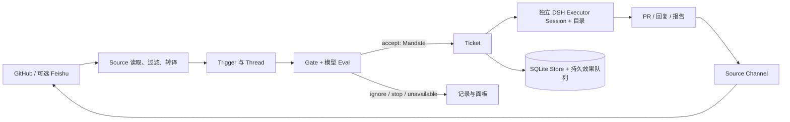

# dsh-superagent：从消息入口到可恢复的代码交付

状态：上游源码与文档分析 · 2026-11-01。分析对象为 DeepSeek AI 的公开研究原型，不是 Nuska/DS-bot 的实现，也不是运行效果评测。

## 问题与范围

这份分析回答三个问题：dsh-superagent 如何把聊天或 GitHub 消息变成受策略约束的代码任务；它如何执行、交付并从故障中恢复；其中哪些边界适合 DS-bot 复用或集成。

## 结论摘要

- dsh-superagent 不是聊天平台，也不是通用通信标准。它是运行在 DeepSeek Harness（DSH）中的单仓库 Agent bundle：GitHub 是主要入口，Feishu 是可选入口；来源适配器把平台事件转成内部 Trigger，再通过 Source 的 Channel 发回结果。[README](https://github.com/deepseek-ai/dsh-superagent-prototype/blob/6337fc823ce20251c8de8085948165c81aaa701e/README.md) · [领域模型](https://github.com/deepseek-ai/dsh-superagent-prototype/blob/6337fc823ce20251c8de8085948165c81aaa701e/docs/001-domain.md)
- 它的关键设计是把“收到消息”和“获准执行”分开：策略门禁与模型评估生成 Decision 和不可变 Mandate；获准后创建 Ticket，由独立 Executor Session 与目录执行。Thread 订阅负责把后续上下文交给已有 Ticket，不会扩大授权范围。[授权模型](https://github.com/deepseek-ai/dsh-superagent-prototype/blob/6337fc823ce20251c8de8085948165c81aaa701e/docs/002-authorization.md) · [执行模型](https://github.com/deepseek-ai/dsh-superagent-prototype/blob/6337fc823ce20251c8de8085948165c81aaa701e/docs/003-execution.md)
- 它实现了应用内部的 Source 扩展接口，但这不是可独立部署的跨平台通信协议。DS-bot 可以借鉴其 Source/Trigger/Channel 的分层；若要让 dsh-superagent 接收 DS-bot 所在渠道的请求，则要适配 DSH 插件、会话、策略和状态模型，不能只接一个聊天 Webhook。[Source 接口](https://github.com/deepseek-ai/dsh-superagent-prototype/blob/6337fc823ce20251c8de8085948165c81aaa701e/src/sources/kind.ts) · [扩展指南](https://github.com/deepseek-ai/dsh-superagent-prototype/blob/6337fc823ce20251c8de8085948165c81aaa701e/docs/008-cookbook.md)
- 原型把 SQLite 持久化、效果队列、Ticket 状态和 DSH Session 恢复组合起来，提供了可审计、可重试的流程；但部署权限仍以操作者 OS 用户为边界。文档明确指出 worker preset 使用 `danger-full-access`，命令包装和 blocked-command 列表不是安全沙箱。[部署与权限](https://github.com/deepseek-ai/dsh-superagent-prototype/blob/6337fc823ce20251c8de8085948165c81aaa701e/docs/006-deployment.md) · [架构](https://github.com/deepseek-ai/dsh-superagent-prototype/blob/6337fc823ce20251c8de8085948165c81aaa701e/docs/007-architecture.md)

## 快照与方法

- 上游：[`deepseek-ai/dsh-superagent-prototype`](https://github.com/deepseek-ai/dsh-superagent-prototype)，`main` 快照 `6337fc823ce20251c8de8085948165c81aaa701e`，提交日期 2026-10-31；该提交是仓库公开原型的初始提交。
- 材料：该提交中的 README、`docs/000` 至 `docs/008`、`SETUP.md`、`package.json`，以及 `src/core`、`src/app`、`src/executor`、`src/sources` 的实现。主要以编号文档梳理概念，再用源码核对关键扩展点和状态归属。
- 未安装或运行该原型，未验证 GitHub/Feishu 账号配置，也未测量完成率、恢复成功率、安全性或延迟。下文“实现事实”表示在此源码快照中有文档或代码依据；“推断”用于 DS-bot 的集成判断。
- DS-bot 对照沿用 Nuska 对 `ds-bot@0.2.3` / commit `4a7b55069ad300eae8be42a74f31bc170b40ead7` 的既有静态研究；本报告没有重新检查 DS-bot 当前上游主线或运行它。[源码能力审阅](2026-10-29-dsh-multi-bot-composition-review.md) · [任务执行对照](2026-10-29-dsbot-vs-tobs-execution.md)

## 系统如何运行

这是对实现结构的概括，不代表上游运行时的精确部署拓扑。[领域流程](https://github.com/deepseek-ai/dsh-superagent-prototype/blob/6337fc823ce20251c8de8085948165c81aaa701e/docs/001-domain.md) · [Runtime 和状态模块](https://github.com/deepseek-ai/dsh-superagent-prototype/blob/6337fc823ce20251c8de8085948165c81aaa701e/docs/007-architecture.md)

### 1. 来源层：平台事件被转译，不共享一个“聊天标准”

`Source` 是一类事件来源及其配置实例。GitHub 和 Feishu 分别负责自己的身份、事件读取、线程识别和消息发送；它们把平台消息映射成统一的内部 Trigger。Trigger 带有 actor、时间、正文、来源原生元数据、所属 Thread 和 Channel 地址。Thread 聚合时间顺序上的消息；Channel 是发回原会话的写侧。[领域术语与映射](https://github.com/deepseek-ai/dsh-superagent-prototype/blob/6337fc823ce20251c8de8085948165c81aaa701e/docs/001-domain.md) · [GitHub Source](https://github.com/deepseek-ai/dsh-superagent-prototype/blob/6337fc823ce20251c8de8085948165c81aaa701e/src/sources/github.ts) · [Feishu Source](https://github.com/deepseek-ai/dsh-superagent-prototype/blob/6337fc823ce20251c8de8085948165c81aaa701e/src/sources/feishu.ts)

新来源要实现的 `SourceKind` 包含配置 schema、设置表单、健康项、监听范围、可选的 Channel、线程上下文读取、策略部分、身份/执行环境变量等。Source 通过较窄的 `SourceContext` 写入事件和访问 Ticket 操作。`docs/008-cookbook.md` 还要求新适配器定义稳定的 Trigger/Thread/Channel ID、消息去重、回复幂等、授权身份映射和轮询/事件循环。因此扩展点是有具体语义的进程内 TypeScript 接口，而非平台无关的消息 wire protocol。[SourceKind 类型](https://github.com/deepseek-ai/dsh-superagent-prototype/blob/6337fc823ce20251c8de8085948165c81aaa701e/src/sources/kind.ts) · [新增 Source 的步骤](https://github.com/deepseek-ai/dsh-superagent-prototype/blob/6337fc823ce20251c8de8085948165c81aaa701e/docs/008-cookbook.md)

### 2. 授权层：门禁、评估、授权范围各有职责

- Source 先滤掉不监听的范围和 Agent 自己发出的消息，并将平台身份放进 Trigger。
- Gate 根据来源自己的 allowed list、消息是否提及 Agent、发送者是否为人或已知 bot，以及 admission table 决定能否成为显式请求、推断候选或不予准入。
- 模型 Eval 在带有线程上下文和当前策略的候选上作判断。`observe` 模式记录本可接单的推断请求而不执行；自动接受仍受规则匹配与门禁结果约束。
- 接受后形成 Mandate，记录所依赖的策略版本、范围、强度、匹配规则、来源身份及触发方式。Ticket 的订阅可继续传入讨论上下文，但不能扩大 Mandate。策略变化会通知相关运行中的 Ticket；恢复已结束的 Ticket 前会重新验证授权。[授权规则](https://github.com/deepseek-ai/dsh-superagent-prototype/blob/6337fc823ce20251c8de8085948165c81aaa701e/docs/002-authorization.md) · [策略实现](https://github.com/deepseek-ai/dsh-superagent-prototype/blob/6337fc823ce20251c8de8085948165c81aaa701e/src/policy.ts)

这里的模型评估并不替代确定性权限门禁；反过来，Ticket 是已授权工作对象，也不意味着模型交付一定正确。两者分别解决“是否能做”和“做得是否合格”。

### 3. 执行层：一 Ticket 一 Session、一目录

每个 Ticket 绑定一个 Assignment 和一个 DSH Executor Session，目录默认在 `<stateDir>/work`。通常由 `prepare` 命令在目录创建仓库 worktree；每 Ticket 独立的 git 分支和 PR 可以按配置实现。worker 读取原始来源、处理范围内后续请求、运行工具并报告 `progress / waiting / ready / blocked / failed / dropped` 等结构化状态。主 Session 是 router/assessor：转发候选、做路由决策、收集 Worker 报告和需要人工处理的问题，本身不负责代码实现。[执行流程](https://github.com/deepseek-ai/dsh-superagent-prototype/blob/6337fc823ce20251c8de8085948165c81aaa701e/docs/003-execution.md) · [Prompt 职责](https://github.com/deepseek-ai/dsh-superagent-prototype/blob/6337fc823ce20251c8de8085948165c81aaa701e/docs/004-prompts.md)

PR 与 Ticket 生命周期相连：worker 报告 PR 后，Source 继续跟踪 PR 上的讨论和 CI；Ticket 是否结束取决于 worker 状态与相关 PR 的状态。Auto-merge 行为由可编辑的 Delivery requirements prompt 指导，部署建议仍由 GitHub branch protection 等外部规则强制。由此可见“完成”同时涉及 Agent 报告、Ticket 状态和外部交付物，不能只看模型最后一句。[PR 与结束条件](https://github.com/deepseek-ai/dsh-superagent-prototype/blob/6337fc823ce20251c8de8085948165c81aaa701e/docs/003-execution.md) · [Prompt 优先级](https://github.com/deepseek-ai/dsh-superagent-prototype/blob/6337fc823ce20251c8de8085948165c81aaa701e/docs/004-prompts.md)

### 4. 持久化、恢复与人工监督

`Store` 用 SQLite 保存核心域记录、设置和版本、Prompt 历史、消息回执及其他键值状态；单实例状态目录锁防止多个进程并发写入。`Effects` 把 assessment、launch、delivery、relay、notice、reply 等副作用先存入 SQLite，再按种类限流、排序、退避重试。重启时，运行中的 Assignment 结束并重新启动，Worker 收到恢复提示，需要核对目录、git 和 GitHub 状态后再重复外部操作；待处理输入与执行记录持久保留。该机制降低消息丢失和盲目重跑风险，但文档没有声称它能恢复进程内正在运行的任意 shell/子代理。[架构中的 Store/Effects](https://github.com/deepseek-ai/dsh-superagent-prototype/blob/6337fc823ce20251c8de8085948165c81aaa701e/docs/007-architecture.md) · [执行恢复规则](https://github.com/deepseek-ai/dsh-superagent-prototype/blob/6337fc823ce20251c8de8085948165c81aaa701e/docs/003-execution.md)

Web 面板将“需人处理的 Ticket、系统健康、执行负载和历史记录”放在同一监督面，允许审阅 Decision/Mandate、处理 Attention、停止或重试 Ticket、检查来源和设置；运行状态有专门健康项与本地管理 API。[面板](https://github.com/deepseek-ai/dsh-superagent-prototype/blob/6337fc823ce20251c8de8085948165c81aaa701e/docs/005-panel.md) · [管理 API](https://github.com/deepseek-ai/dsh-superagent-prototype/blob/6337fc823ce20251c8de8085948165c81aaa701e/docs/006-deployment.md)

### 5. 部署边界与风险

原型需要单独 DSH Web profile、模型提供商、GitHub 上的 Agent 用户账户及独立 `gh` wrapper。Feishu bot 可选。worker preset 以操作者 OS 用户身份使用 `danger-full-access`；文档建议需要隔离时使用专用 OS 账号。`PATH` shim、Git 配置和 blocked-command 名称用于防止误用个人 CLI、固定默认身份和命令限制，但不能阻止 worker 通过绝对路径运行程序或读取该 OS 用户可读的文件。因此它的“Ticket 目录隔离”主要是工作区组织与执行边界，不等同于操作系统沙箱。[账号和权限说明](https://github.com/deepseek-ai/dsh-superagent-prototype/blob/6337fc823ce20251c8de8085948165c81aaa701e/docs/006-deployment.md) · [worker 命令与变量](https://github.com/deepseek-ai/dsh-superagent-prototype/blob/6337fc823ce20251c8de8085948165c81aaa701e/docs/003-execution.md)

## 对 DS-bot 的集成判断

以下是基于 dsh-superagent 扩展契约与模块边界的推断，不是已实现或测试过的集成。DS-bot 侧的参照版本是上述 `0.2.3` 快照；其接口与运行时应再对照目标部署所用版本核实。

| 方向 | 做法 | 合适的条件与代价 |
| --- | --- | --- |
| DS-bot 作为新 Source | 在 dsh-superagent 进程中实现 `SourceKind`，把 DS-bot 平台事件映射成 Trigger，并实现 Channel 回复、线程上下文读取、策略身份、监听范围和健康状态。 | DS-bot 主要承担消息入口/渠道，而任务授权、Ticket、独立 worker 和交付由 dsh-superagent 承担。需要 TypeScript/DSH 插件接入；必须把授权 ID、幂等 ID、线程语义设计清楚。Cookbook 给出了类似 webhook 队列的参考实现。 |
| DS-bot 调用管理 API | 通过本地管理 API 查看状态、设置以及停止/重试 Ticket。 | 适合运维面板互通；文档 API 重点是设置和管理动作，不能仅凭它认定存在稳定的通用任务提交/回复协议。若要让 DS-bot 直接派工，需新增并约束 intake API，而非复用 `PUT settings`。 |
| 复用域模型或执行设计 | 将 Trigger、授权、Ticket、Assignment、交付回执等概念映射到 DS-bot 自己的任务层；或把无 I/O 的 `src/core` 作为移植参考。 | DS-bot 若已有会话、身份、路由、任务执行机制，可能更适合只借鉴授权/工单/恢复语义。直接复用完整应用会连带 DSH Session、面板、SQLite 和 GitHub/Feishu 假设，耦合较重。 |
| GitHub 作异步桥 | DS-bot 与 dsh-superagent 分别在 GitHub 上交接 Issue/PR 和评论。 | 可用于小范围试运行；身份、回环过滤、重复任务、同一仓库并发修改和哪个 Agent 对结果负责必须明确。它是平台层耦合，不是实时的 Agent-to-Agent 通讯协议。 |

### 建议

若目标是“给现有 DS-bot 增加持久任务和可追踪交付”，优先把 dsh-superagent 当作**工作流与执行模型的参考**：先核对 DS-bot 已有的对话、Agent 身份、后台执行、状态持久化和交付能力，再决定移植 Ticket/授权/恢复这些控制面概念。若目标是“让 dsh-superagent 接受 DS-bot 当前所在渠道的请求”，才优先评估 `SourceKind` 适配器；开始前要先验证 DS-bot 是否能提供稳定的事件 ID、线程读取、发言身份和幂等回复接口。

更稳妥的边界是保留 DS-bot 当前的用户交互与 Agent 运行时，只把可验证交付能力逐步加入其任务控制层；不要默认两个运行时可以共享 Ticket 状态或相互恢复 Session。这个建议是架构推断，仍需结合 DS-bot 的当前代码和一个端到端原型验证。

## 适用范围、缺口与后续问题

这是公开单提交快照的代码阅读报告。上游 README 将项目标为供参考的研究原型，说明发布版本不等同于内部实现或论文中描述的系统；功能文档也不能代替运行证据。[README 限定](https://github.com/deepseek-ai/dsh-superagent-prototype/blob/6337fc823ce20251c8de8085948165c81aaa701e/README.md)

建议后续核实：

1. 用一次短 Issue 任务实测从评论、授权、Ticket、独立 worktree 到 PR/回帖的完整链路，并记录延迟、人工介入和失败状态。
2. 注入网络中断、进程重启、重复评论和 PR 被关闭等情况，核对持久队列、恢复提示和外部副作用去重。
3. 把 DS-bot 当前任务状态机与 Trigger、Mandate、Ticket、Assignment、Report 做逐项映射，确认职责重叠以及唯一的最终交付负责人。
4. 若考虑新 Source，先用一个不可执行的 observe/测试来源验证事件身份、线程上下文、消息幂等与权限门禁，再接真实执行。
5. 在任何真实仓库试运行前，确定专用 OS 身份或其他隔离策略，并核对 worker 可读路径、GitHub token、可写仓库和 PR 合并规则。
